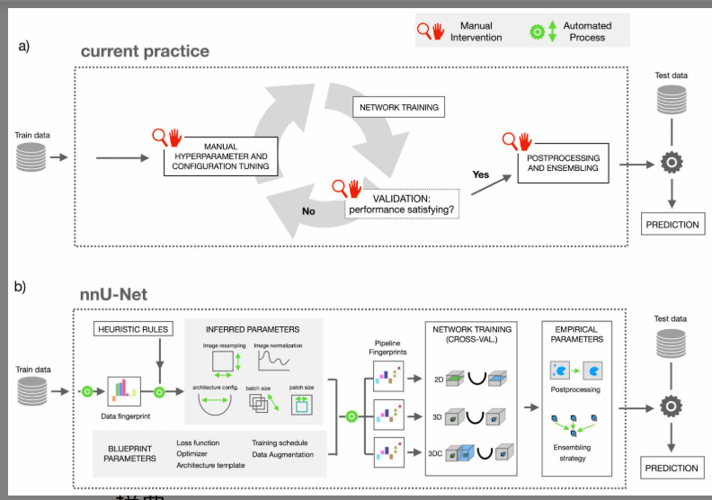

# 论文阅读笔记

## 1. 基本信息

- **标题**: Automated Design of Deep Learning Methods for Biomedical Image Segmentation (nnU-Net：生物医学图像分割深度学习方法的自动化设计)
- **作者**: Fabian Isensee, Paul F. Jaeger, Simon A. A. Kohl 等
- **年份 / 会议**: 2020 / arXiv (后发表于 Nature Methods)
- **关键词**: Biomedical Image Segmentation, Automated Machine Learning (AutoML), nnU-Net, U-Net, Deep Learning Pipeline

### 一句话总结
这篇论文主要解决了**生物医学分割任务中模型设计高度依赖专家经验且难以跨数据集迁移**的问题，提出了 **nnU-Net**（"no new net"）框架，通过一套系统的启发式规则自动配置整个分割流水线，最终在 19 个国际竞赛的 49 个任务中实现了 **最先进（SOTA）** 的效果。

---

## 2. 研究背景 with 深度思考

### 背景
生物医学图像（如 CT、MRI、电镜）在临床诊断和科学研究中至关重要。虽然深度学习（特别是 U-Net）已成为主流，但其性能极度依赖于**流水线配置**（Pipeline Configuration），包括预处理、超参数设置、训练策略等。

### 现有方法的问题
1.  **高度依赖专家经验**：针对不同器官或模态，研究人员通常需要手动调整架构（如增加残差连接、注意力机制等）和超参数，过程繁琐且难以复现。
2.  **过度关注架构变体**：学术界涌现了数以万计的 U-Net 变体，但作者认为，这些“新网络”带来的增益往往被不佳的流水线设置所掩盖。
3.  **计算资源浪费**：现有的 AutoML 方法（如神经网络架构搜索 NAS）需要极高的计算成本，普通实验室难以负担。

### 论文要解决的问题
作者想证明：**一个配置得当的标准 U-Net 架构，配合自动化的、系统化的流水线设计规则，能够战胜绝大多数精心设计的专用模型。**

---

## 3. 核心方法

### 核心思想
nnU-Net 的核心不在于发明“新网络”，而在于发明一套**自动化的决策系统**。它将设计决策分为三类：
1.  **Blueprint（蓝图参数）**：固定的设计，如损失函数（Dice+CE）、训练周期、数据增强策略。
2.  **Inferred（推导参数）**：根据数据集的“指纹”通过启发式规则自动计算，如 patch 大小、网络深度、重采样策略。
3.  **Empirical（经验参数）**：通过交叉验证确定的决策，如模型集成和后处理。

### 方法流程

**数据集指纹 (Data Fingerprint)**（如图像尺寸、体素间距、类别分布、硬件约束）
↓
**启发式规则引擎 (Heuristic Rules)**（计算 patch 大小、池化步长、网络深度、批大小等）
↓
**生成流水线指纹 (Pipeline Fingerprint)**（生成 2D、3D fullres、3D cascade 三种配置）
↓
**自动化训练与交叉验证**（5 折交叉验证，确定最佳模型或集成方案）
↓
**推理与自动化后处理**（如连通分量分析）

### 与已有方法的区别
- **对比传统手动方法**：去除了“人工调优”环节，实现了真正的端到端自动配置。
- **对比 NAS/AutoML**：NAS 搜索的是架构，而 nnU-Net 锁定架构，搜索的是**流水线全过程**。且 nnU-Net 基于规则推导，不需要像 NAS 那样进行成千上万次的试错训练，计算效率极高。

---

## 4. 实验

### 实验环境
- **数据集**: Medical Segmentation Decathlon (MSD, 10个任务) 加上其他 9 个竞赛数据集，共 49 个任务。
- **硬件**: 单台 NVIDIA Titan Xp / GTX 1080 Ti (11GB 显存)。
- **Baseline**: 各个国际竞赛的顶尖专门化算法。
- **主要指标**: Dice Coefficient (DC), Hausdorff Distance (HD)。

### 主要实验结果

| 实验 | 比较内容 | 结果 | 说明 |
|---|---|---|---|
| 全球竞赛表现 | nnU-Net vs. 专门设计的算法 | 49 个任务中 29 个排名第一 | 证明了通用规则可以击败手动调优。 |
| 架构变体对比 | 基础 U-Net vs. 复杂变体 | 基础架构在调优后更强 | 复杂的架构改进（如残差、注意力）并非性能的关键。 |
| 配置鲁棒性 | 不同任务间的参数迁移 | nnU-Net 自动适应度极高 | 能够处理从微观电镜到宏观 MRI 的巨大跨度。 |

### 最重要的图
**Figure 2 (Manual vs. nnU-Net workflow)**

这张图对比了传统“人工试错循环”与 nnU-Net 的“数据集指纹 -> 规则 -> 自动配置”流程。  
**我的理解**：这反映了作者将“领域知识”从具体的模型设计转化为**抽象的生成算法**。它不仅给出了一个工具，更给出了一套生物医学分割的最佳实践准则。

---

## 5. 论文贡献

1.  **系统化规则**：首次将医学图像处理的专家经验总结为一套可解释、可执行的启发式规则。
2.  **nnU-Net 框架**：提供了一个开箱即用的开源工具，极大降低了非 AI 专家进入医学影像研究的门槛。
3.  **范式转变**：通过实验证明了**流水线配置比网络架构更重要**，引导社区回归到对基础模型和数据处理的关注。

**最重要的是**：它证明了领域知识（Domain Knowledge）可以通过“硬编码”规则的方式与深度学习完美结合。  
**原因**：这避免了黑盒搜索（NAS）的盲目性，同时解决了手动调优的不可复现性。

---

## 6. ⭐ 我的思考

### 我觉得做得好的地方
- **大道至简**：在所有人都在卷复杂架构时，作者敢于提出“No New Net”，回归 U-Net 本质。
- **极致的鲁棒性**：在 49 个完全不同的分割任务上验证，这种实验量在学术界非常罕见且极具说服力。

### 我觉得存在的问题
- **计算资源门槛**：虽然不需要 NAS 那么夸张，但默认的 5 折交叉验证和 1000 epoch 训练对于算力有限的机构仍有压力。
- **规则的局限性**：启发式规则是基于作者的经验总结的，如果硬件环境或基础架构发生剧变（如 Transformer 取代 CNN），这些规则可能需要重写。

### 我没看懂 / 有疑问的地方
- 在极端各向异性（Anisotropic）的数据中，nnU-Net 的伪 2D 策略是否真的是最优解？
- 级联（Cascade）策略触发的 12.5% 阈值是如何确定的？

### 为什么这个方法有效？
1.  **自适应的感受野**：通过规则确保网络的感受野始终能覆盖足够的上下文信息（Context），这是分割任务的核心。
2.  **显存平衡**：它自动在 Patch 大小、Batch 大小和网络深度之间做权衡，确保在有限的 11GB 显存下发挥最大性能。
3.  **消除过拟合**：强大的数据增强、损失函数组合和集成学习，提供了极强的泛化能力。

### 如果让我改进
1.  **引入轻量化分支**：增加针对移动端或实时分割的自动配置规则。
2.  **混合架构支持**：将 Transformer 模块（如 Swin-UNet）作为可选的 Blueprint 模板。

### 我还想做什么实验？
- 测试 nnU-Net 在 **极少量样本（Few-shot）** 情况下的表现，看其规则是否依然稳健。
- 验证其规则在 **病理图像（WSI）** 等超大尺寸图像上的适用性。

---

## 7. 总结

### 这篇论文解决了什么？
解决了生物医学图像分割中，由于数据多样性导致的模型配置困难和性能不稳定的问题。

### 怎么解决的？
通过提取数据集特征（指纹），利用预设的启发式专家规则，自动生成包括预处理、架构、训练和后处理在内的完整流水线。

### 效果怎么样？
在没有任何手动干预的情况下，nnU-Net 成为多项国际竞赛的冠军，设定了医学分割领域的新基准。

### 对我有什么启发？
**“细节决定成败”**。在深度学习研究中，不要盲目追求复杂的模型架构，系统地处理好数据、超参数和训练策略往往能带来更本质的提升。

### 是否值得复现？
**是**。  
**原因**：nnU-Net 已经成为医学影像分割的标杆（Baseline），任何新提出的分割算法都应该与配置得当的 nnU-Net 进行公平对比。此外，其开源代码库维护极好，非常适合作为科研起点。