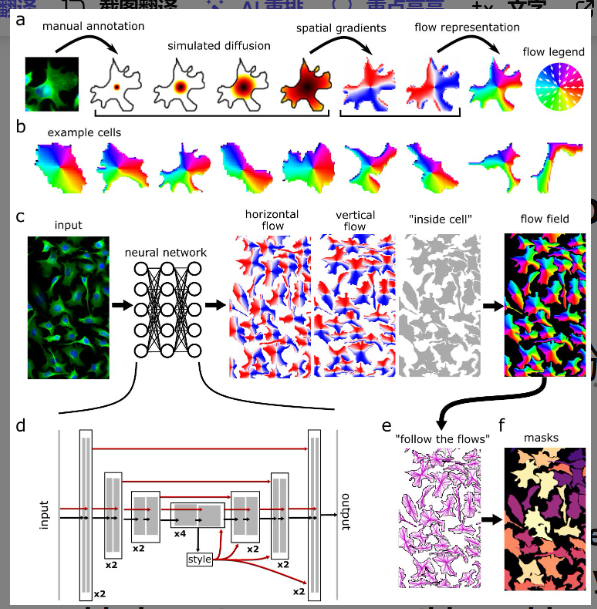
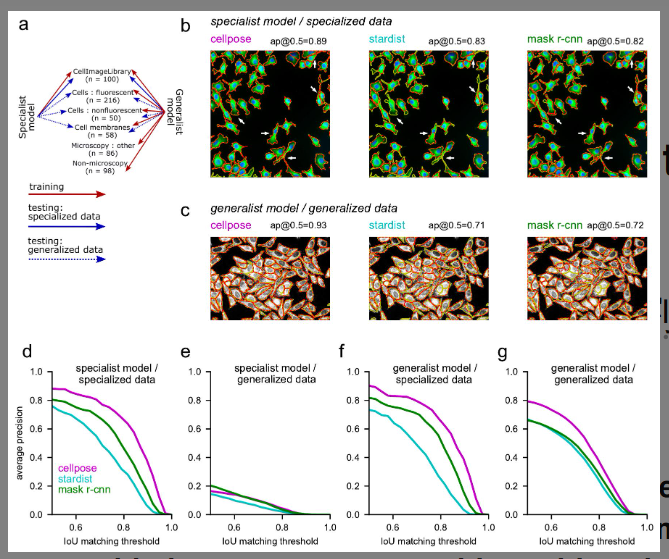

# 论文阅读笔记

## 1. 基本信息

- **标题:** Cellpose: a generalist algorithm for cellular segmentation
- **作者:** Carsen Stringer, Tim Wang, Michalis Michaelos, Marius Pachitariu
- **年份 / 会议:** 2020 / bioRxiv (后发表于 Nature Methods)
- **关键词:** 细胞分割 (Cellular Segmentation), 深度学习 (Deep Learning), 通用算法 (Generalist Algorithm), 矢量流 (Vector Flows)

### 一句话总结
这篇论文主要解决了**生物影像分割中深度学习模型泛化性差、难以处理非球形复杂形状**的问题，提出了**基于热扩散模拟的矢量流表示方法 (Vector Flow Representation)**，最终实现了**无需重新训练即可在多种显微镜模态和细胞类型下达到人类水平的通用分割**效果。

---

## 2. 研究背景与问题

### 背景
定量生物学需要精确测量细胞的形态、位置和表达量。过去十年，深度学习虽然在分割任务上取得了巨大进步，但大多数算法都是“专家型”的，即只能在特定数据集上表现良好。

### 现有方法的问题
1.  **泛化能力弱：** 针对特定实验室或特定细胞类型训练的模型，在面对新的显微镜模态（如荧光 vs 明场）时表现糟糕。
2.  **表达能力不足：** 传统方法（如 Watershed 或基于质心的 StarDist）假设细胞是类圆形的（blob-like）。当遇到带有长突起的神经元或形状不规则的细胞时，这些方法无法精确勾勒边界。
3.  **数据标注成本高：** 3D 数据的标注极其耗时，且缺乏大规模的通用标注数据集。

### 论文要解决的问题
作者旨在开发一种“通用型”模型，能够处理极具多样性的细胞形状，并在未见过的图像类型上保持高精度，同时探索无需 3D 标注实现 3D 分割的方法。

---

## 3. 核心方法

### 核心思想
Cellpose 不直接预测细胞边界，而是预测一个 **“拓扑图”或“矢量流场”**。它模拟从细胞中心发散的热量扩散，产生指向中心的梯度流。每个像素只需顺着预测的“流方向”移动，最终汇聚到同一个中心点的像素就被归为同一个细胞。

### 方法流程

**问题：** 复杂形状细胞难以通过简单几何模型分割。  
↓  
**分析：** 传统的二值掩码或质心模型缺乏描述任意形状的灵活性。  
↓  
**提出方法：** 基于热扩散模拟的逆向变换，将掩码转为水平/垂直梯度图。  
↓  
**具体实现：** 
1. 模拟热扩散，确定细胞中心（热源）。
2. 计算扩散后的空间梯度（矢量流）。
3. 训练 U-Net 预测 (X梯度, Y梯度, 是否在细胞内)。
4. 测试时，通过常微分方程（ODE）追踪像素路径。

↓  
**得到结果：** 像素自动汇聚成实例掩码。

### 与已有方法的区别
相比 Mask R-CNN 或 StarDist，Cellpose 最大的改变是**引入了矢量流表示法**。它不依赖于候选框或径向对称性，因此可以追踪极其复杂的细胞轮廓（如树突），且通过大规模多样化数据集训练，具备了极强的“零样本”迁移能力。

---

## 4. 实验

### 实验环境
- **数据集:** 收集了包含 70,000+ 个对象的自定义数据集（荧光、明场、膜标注、甚至包括非生物类重复物体如石头、水果）。
- **硬件:** NVIDIA GPU 环境（文中提到利用 MXNet 框架）。
- **Baseline:** Stardist, Mask R-CNN。
- **主要指标:** 平均精度 (Average Precision, AP)，在不同 IoU 阈值下评估。

### 主要实验结果

| 实验 | 比较内容 | 结果 | 说明 |
|---|---|---|---|
| 实验 1 | 专门数据集 (CellImageLibrary) | Cellpose (AP=0.88) > Stardist (0.76) / Mask R-CNN (0.80) | 证明了 Cellpose 在处理复杂形状时的强大表达能力。 |
| 实验 2 | 通用数据集 (Generalized Data) | Cellpose (AP=0.82) 远超基准模型 (0.68-0.70) | 证明了通用模型比特定模型具有更好的鲁棒性。 |
| 实验 3 | 3D 分割测试 | 2D 训练模型在 3D 任务上超过了手动优化的 ilastik 流程 | 证明了无需 3D 标注，仅靠 2D 切片融合也能实现高精度 3D 分割。 |

### 最重要的图

**Figure 1:** 展示了从手动标注到模拟扩散再到矢量流的转换过程。
   
  
**Figure 3:** 展示了 Cellpose 在不同 IoU 阈值下的性能曲线，特别是在高 IoU 要求下，Cellpose 的优势更加明显。
- **这张图说明:** 传统的“专家型”模型在通用测试集上会发生灾难性的性能下降，而 Cellpose 其性能退化远小于传统模型。”。
- **我的理解:** 这种“流”的设计本质上是为图像中的每个像素建立了一个“导航系统”，使其能准确找到所属的实体中心。

---

## 5. 论文贡献

主要有:
1. **算法创新：** 提出了将细胞实例分割转化为预测空间矢量流的问题，有效解决了重叠和复杂形状分割难题。
2. **数据集贡献：** 发布了一个高度多样化的细胞图像数据集，涵盖了多种模态。
3. **架构优化：** 改进了 U-Net，引入了全局风格向量（Style Vector）来适应不同类型的图像。
4. **3D 扩展：** 提出了一种巧妙的方法，仅利用 2D 模型通过多平面融合实现 3D 分割。

**其中最重要的是：矢量流表示法 (Vector Flow Representation)。**  
**原因：** 这是 Cellpose 能够处理任意形状（Generalist 能力）的底层逻辑。它打破了“细胞必须是圆的”这一隐性假设。

---

## 6. ⭐ 我的思考

### 我觉得做得好的地方
- **数学建模的优雅：** 利用热扩散物理过程来生成训练标签，非常巧妙地解决了数学上的连续性问题。
- **工程实用性：** 提供了 GUI 工具，并支持社区贡献数据，形成闭环。

### 我觉得存在的问题
- **计算开销：** 推理时需要运行动力学系统（像素移动汇聚），相比于直接的端到端掩码预测，计算量稍大。
- **紧密堆积极限：** 虽然对紧密包装效果好，但在某些极端重叠（如细胞完全重叠而非仅仅接触）的情况下可能仍有挑战。

### 我没看懂 / 有疑问的地方
- 在 3D 扩展中，作者提到融合 XY, XZ, YZ 三个平面的梯度，对于各向异性（各层分辨率不同）的显微镜数据，这种融合的权重是如何动态调整的？

### 为什么这个方法有效?
从原理上讲，矢量流将**离散的实例分割任务**转换为了**连续的回归任务**。这种连续性使得深度学习模型更容易学习到平滑的特征。同时，指向中心的流场具有很强的拓扑约束力，能够自然地分离相邻物体的边界。

### 如果让我改进
1. **引入 Transformer 骨干：** 现在的 Cellpose 基于 U-Net，如果引入全局注意力机制，可能对超大细胞的长程依赖捕捉得更好。
2. **实时性优化：** 尝试将后处理的动力学汇聚过程用更快的矩阵运算替代。

---

## 7. 总结

### 这篇论文解决了什么?
- 解决了细胞分割算法在不同数据集上泛化性差、无法处理复杂不规则形状的问题。

### 怎么解决的?
- 通过热扩散模拟产生矢量流标签，训练 U-Net 预测梯度流，并通过像素汇聚实现分割。

### 效果怎么样?
- 在多个指标上超越了 SOTA（如 Mask R-CNN），尤其在未见过的图像类型上展现了惊人的通用性。

### 对我有什么启发?
- 不要局限于预测边界或掩码，**改变问题的表征方式**（如转化为流场）往往能从底层解决复杂难题。

### 是否值得复现?
- **是**。
- **原因：** Cellpose 已成为生物影像界的标准工具，其代码开源且结构清晰，对于理解基于流的实例分割非常有价值。
