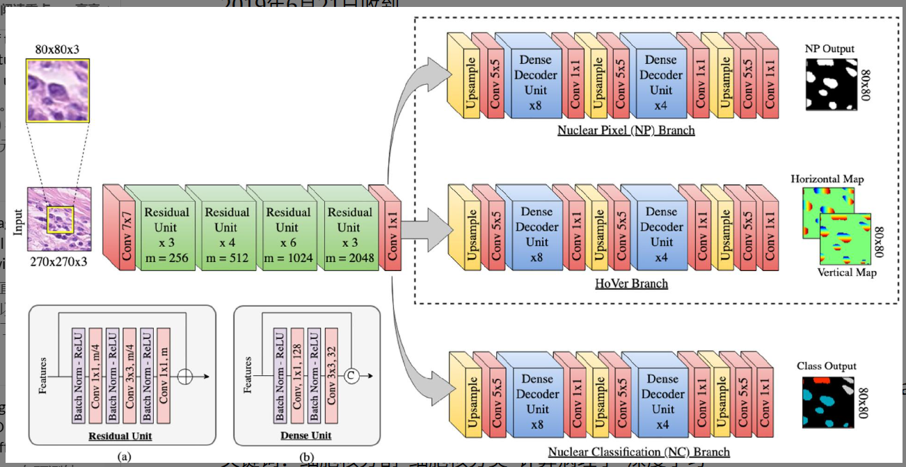

# 论文阅读笔记

## 1. 基本信息

- **标题**: HoVer-Net: Simultaneous segmentation and classification of nuclei in multi-tissue histology images
- **作者**: Simon Graham, Quoc Dang Vu, Shan E Ahmed Raza, et al.
- **年份 / 会议**: 2019 / Medical Image Analysis (Elsevier)
- **关键词**: Nuclear segmentation (细胞核分割), Nuclear classification (细胞核分类), Computational pathology (计算病理学), Deep learning (深度学习)

### 一句话总结

> 这篇论文主要解决了**病理图像中重叠细胞核难以分割及同时分类**问题，提出了 **HoVer-Net** 方法（利用水平和垂直距离图进行实例分割），最终实现了**在多组织数据集上达到 SOTA 的分割与分类精度，且推理速度提升近 10 倍**的效果。

---

## 2. 研究背景与问题

### 背景
在数字病理工作流中，细胞核的精确分割与分类是后续定量分析（如形态学分析、生存预测）的基础。WSIs（全扫描切片）包含数万个细胞核，人工处理效率极低且存在观察者差异。

### 现有方法的问题
1.  **重叠与聚集严重**：肿瘤细胞核常成簇出现，传统基于边界（Boundary-based）的方法难以有效切分相连的实例。
2.  **任务割裂**：大多数方法将分割和分类视为两个独立步骤，增加了计算开销且无法利用任务间的共享特征。
3.  **计算效率低**：如 Mask-RCNN 等基于区域提案（RP）的方法在处理高密度细胞核图像时内存占用大、速度慢。

### 论文要解决的问题
作者旨在设计一个统一的端到端框架，既能利用细胞核内部的几何信息解决重叠分割，又能同时对每个实例进行准确分类。

---

## 3. 核心方法

### 核心思想
HoVer-Net 的核心在于 **“HoVer 支路”**：它不直接预测边界，而是预测每个像素到其所属细胞核**质心（Centre of Mass）的水平（Horizontal）和垂直（Vertical）距离**。利用这种距离图的梯度变化（在两个细胞核交界处，距离值会发生突变），可以精准地提取出个体标记，进而通过分水岭算法实现重叠实例的拆解。

### 方法流程
输入 H&E 图像  
↓  
**Encoder (Preact-ResNet50)**: 提取多尺度特征  
↓  
**三个并行 Decoder 支路**:
1. **NP 支路**: 预测像素属于细胞核还是背景（二值分割）。
2. **HoVer 支路**: 预测像素到质心的水平和垂直距离图。
3. **NC 支路**: 预测每个像素的细胞类别（如肿瘤、上皮、炎性等）。  
   
↓  
**后处理**: 利用 Sobel 算子计算 HoVer 图的梯度，结合 NP 掩码通过分水岭算法分离实例。  
↓  
**得到结果**: 带有类别标签的细胞核实例分割图。

### 与已有方法的区别
相比传统 **基于边界（Boundary-based）** 的方法（如 DCAN），HoVer-Net 转向了 **基于实例丰富信息（Instance-rich）** 的距离回归。相比 **Mask-RCNN**，它采用了全卷积架构，避免了复杂的区域提案过程，在密集场景下更鲁棒且速度更快。

---

## 4. 实验

### 实验环境
- **数据集**: CoNSeP (新引入), Kumar, CPM-17, TNBC, CRCHisto。
- **硬件**: 2 x NVIDIA GeForce 1080 Ti。
- **Baseline**: U-Net, Mask-RCNN, DCAN, Micro-Net, DIST, CIA-Net 等。
- **主要指标**: DICE, AJI, **PQ (Panoptic Quality)**, F1-score。

### 主要实验结果

| 实验 | 比较内容 | 结果 | 说明 |
|---|---|---|---|
| 分割精度 | HoVer-Net vs. SOTA | 多个数据集 AJI/PQ 第一 | 在 Kumar 数据集上 AJI 达到 0.618，显著优于 baseline。 |
| 分类精度 | 不同分支结构对比 | 三分支优于两分支 | 独立的 NC 分支能有效解耦分割与分类任务。 |
| 推理速度 | vs. Mask-RCNN | 快 9.7 倍 | 处理 1000x1000 图像，HoVer-Net 仅需 11.04s，而 Mask-RCNN 需 106.98s。 |

### 最重要的图
**Figure 2 (架构图)**  
  
**我的理解**: 这种设计本质上是利用了细胞核内部的几何结构属性。相比于模糊的边界，内部像素到中心的相对位置更稳定，且在两个不同中心的作用下，交界处必然产生“断层”，这是解决重叠问题的降维打击。

---

## 5. 论文贡献

我认为主要有:
1.  **HoVer-Net 架构**: 创新的三支路设计，利用水平/垂直距离回归解决重叠分割。
2.  **CoNSeP 数据集**: 贡献了一个包含 24,319 个详尽标注和分类标签的高质量结直肠癌数据集。
3.  **评价指标改进**: 提倡使用 PQ 指标来综合衡量检测与分割质量，并提出了针对分类的 $F_c^t$ 指标。

其中最重要的是: **HoVer 支路的设计理念**。
原因: 它改变了传统的边界分割思维，提供了一种处理密集小物体实例分割的高效回归方案。

---

## 6. ⭐ 我的思考

### 我觉得做得好的地方
- 巧妙地将几何位置信息转化为回归任务，避免了传统分水岭算法中“种子点”难以确定的问题。
- 实验非常详尽，跨越了 6 个不同来源的数据集，证明了极强的泛化能力。

### 我觉得存在的问题
- 后处理步骤（Sobel + 分水岭）虽然有效，但仍然依赖于手动调优的超参数（如阈值 $h$ 和 $k$），如果能将其整合进端到端流程会更完美。

### 我没看懂 / 有疑问的地方
- 对于形态极度不规则（非凸）的细胞核，中心点（Centre of Mass）可能落在核外，此时 HoVer 的距离回归是否会失效？

### 为什么这个方法有效?
因为它引入了**实例敏感的强约束**。二值分割只知道“是细胞”，边界预测只知道“是边缘”，而 HoVer 回归让每个像素都知道“我属于哪个中心”，这种全局坐标感的引入使得即使物理上相连的细胞在特征空间也能被轻易切开。

### 如果让我改进
1.  **后处理神经网络化**: 尝试使用神经网络（如 Deep Watershed）替代传统的分水岭，实现全流程端到端训练。

---

## 7. 可迁移 / 可复用 / 可组合点

### 7.1 可迁移的框架或思路
- **多任务解耦思路**: 分割、测距、分类三位一体的并行解码器框架可迁移至任何“密集小目标检测+分类”场景（如卫星图像中的建筑分割、工业缺陷检测）。
- **HoVer 建模方式**: 将像素与中心的相对位置作为回归目标，是解决“粘连物体分割”的通用范式。

### 7.2 可复用的模块 / 组件
- **Preact-ResNet50 修改版**: 调整了下采样步长（从 32 倍降到 8 倍）以保留空间细节的 Encoder 方案。
- **PQ 指标评价体系**: 这种全景分割的评价逻辑非常适合医学图像领域。

### 7.3 可与其他文章组合的点
- **与 Transformer 组合**: 用 Swin Transformer 替换 ResNet 骨干，可能进一步提升长距离依赖建模，改善大细胞核的回归精度。
- **与自监督学习组合**: 利用大量无标注病理图像进行预训练，再在 CoNSeP 等小数据集上微调。

### 一句话迁移结论
这篇文章最值得迁移的是**利用水平/垂直距离回归进行实例分离的思路**，最适合迁移到**工业或生物医学中物体高度密集且相互重叠**的问题。

---

## 8. 总结

### 这篇论文解决了什么?
  解决了病理图像中聚集细胞核的精确实例分割与多类别预测难题。

### 怎么解决的?
提出 HoVer-Net，通过预测像素到质心的水平和垂直距离图，配合 NP 和 NC 分支实现多任务并行处理。

### 效果怎么样?
在多个指标（AJI, PQ）上刷新纪录，且推理速度极快，具备临床落地的潜力。

### 对我有什么启发?
不要只盯着边界看，物体的内部几何结构往往蕴含着更强的分离信息。

### 是否值得复现?
> **是**。代码开源且性能稳健，是病理图像分析领域的经典 Baseline。