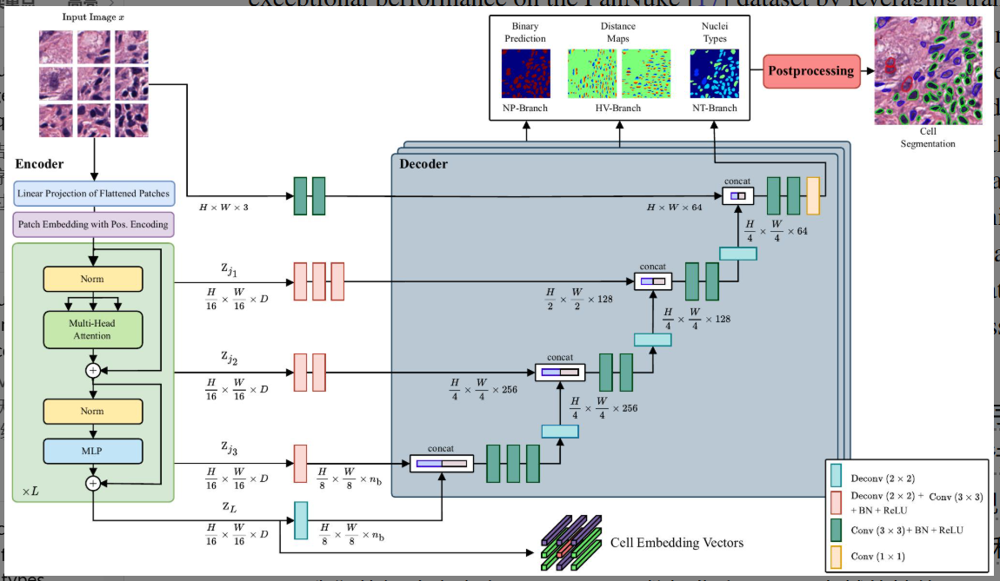

# 论文阅读笔记

## 1. 基本信息

- **标题**: CellViT: Vision Transformers for Precise Cell Segmentation and Classification
- **作者**: Fabian Hörst, Moritz Rempe, Lukas Heine, et al.
- **年份 / 会议**: 2023 / arXiv (eess.IV)
- **关键词**: Cell Segmentation, Digital Pathology, Vision Transformer, Segment Anything (SAM)

### 一句话总结

> 这篇论文主要解决了**病理图像中细胞核检测与分割难以兼顾全局上下文与局部精度**的问题，提出了 **CellViT**（一种基于 Vision Transformer 的类 U-Net 架构），最终实现了在 PanNuke 等挑战性数据集上**SOTA 的分割性能与更快的推理速度**。

---

## 2. 研究背景与问题

### 背景
在数字化病理（WSI）中，细胞核的精确检测和分类是癌症诊断、疗效评估的关键。自动化的计算机视觉算法能显著降低病理学家的工作量并减少主观偏差。

### 现有方法的问题
1. **CNN 的局限性**：传统的卷积神经网络（如 HoVer-Net）受限于局部感受野，难以捕获细胞间的长程空间关系。
2. **特征提取冗余**：现有方法在检测到细胞后，往往需要额外的步骤来提取特征用于下游任务，计算开销大。
3. **推理效率**：处理 Gigapixel 级别的全扫描切片（WSI）时，传统方法通常采用小 Patch（256x256）滑动窗口，重叠区域计算多，耗时长。

### 论文要解决的问题
作者旨在设计一个能够利用 Transformer 的全局建模能力、同时保持高精度分割边缘、并且能直接输出可用于临床分析的细胞特征向量的高效模型。

---

## 3. 核心方法

### 核心思想
CellViT 将 **Vision Transformer (ViT)** 作为编码器整合进 **U-Net 结构**中。它利用大模型（如 SAM 或在 1.04 亿张病理图像上预训练的 ViT）的特征表达能力，通过多分支解码器同时预测细胞类别、二进制掩码和水平/垂直距离图。

### 方法流程
病理 Patch 图像  
↓  
**ViT 编码器**（提取 Patch 级的全局特征，每个 Token 对应 16x16 像素，约为一个细胞大小）  
↓  
**跳跃连接 (Skip Connections)**（将编码器不同深度的特征传给解码器，补偿丢失的细节）  
↓  
**三分支解码器**（NP 分支：二进制分割；HV 分支：距离图辅助分离重叠；NT 分支：细胞类型分类）  
↓  
**后处理**（Marker-controlled Watershed 根据 HV 分支结果分离重叠细胞）  
↓  
得到最终实例分割与分类结果（及每个细胞对应的 Embedding 向量）

### 与已有方法的区别
相比传统方法（如 **HoVer-Net**），最大的改变是**编码器由 CNN 换成了 ViT**，并引入了**大规模领域内预训练（In-domain Pre-training）**。此外，CellViT 能直接从 Transformer 的 Token 中提取细胞嵌入向量，无需二次推理。

---

## 4. 实验

### 实验环境
- **数据集**: PanNuke (19 种组织, 20 万细胞), MoNuSeg (通用性测试), CoNSeP (特征向量测试)。
- **硬件**: NVIDIA A100 (80GB) 或 RTX A6000 (48GB)。
- **Baseline**: HoVer-Net, Mask-RCNN, Micro-Net, DIST, StarDist 等。
- **主要指标**: Panoptic Quality (PQ), F1-detection score, mPQ (multi-class PQ)。

### 主要实验结果

| 实验 | 比较内容 | 结果 | 说明 |
|---|---|---|---|
| 实验 1 | PanNuke 上的分割精度 | mPQ 达到 0.50 | 显著优于 HoVer-Net (0.46) 等 SOTA 模型。 |
| 实验 2 | 细胞检测精度 | F1-score 0.83 | 在上皮细胞等类别上比前人方法提升高达 26%。 |
| 实验 3 | 推理速度 (WSI) | 提升 1.85 倍 | 使用 1024x1024 大 Patch，比 256x256 的 HoVer-Net 快得多。 |

### 最重要的图
**Figure 2 (Network Structure)**
 

这张图说明了 CellViT 的多任务学习架构，展示了 ViT 编码器如何通过 4 个阶段的特征重塑（Reshape）与解码器融合。

**我的理解**: 该设计巧妙地利用了 ViT 的 Token 大小（16px）与细胞实际大小相近的物理特性，使得每个 Token 天然成为了细胞的特征表示。

---

## 5. 论文贡献

我认为主要有:
1. **架构创新**: 首次将 ViT 编码器成功应用于 PanNuke 数据集的细胞实例分割，并结合了类 U-Net 的跳跃连接。
2. **预训练权重的利用**: 证明了使用 **Segment Anything Model (SAM)** 和大规模病理数据预训练的 ViT 能极大地提升医疗影像任务的性能。
3. **推理加速方案**: 提出了适用于 WSI 的大 Patch 推理流程，有效解决了 Transformer 处理高分辨率图像的效率问题。

其中最重要的是: **利用 ViT 的 Token 直接作为细胞特征向量 (Cell Embedding)**。
原因: 这为下游的临床预测（如生存分析、药敏预测）提供了一种“零成本”的特征提取方式。

---

## 6. ⭐ 我的思考

### 我觉得做得好的地方
- 巧妙地平衡了 Transformer 的全局能力和 U-Net 的局部恢复能力。
- 实验非常详尽，涵盖了消融实验、通用性测试、推理速度测试以及特征向量的聚类分析。

### 我觉得存在的问题
- 论文提到模型在 **0.50 µm/px (20x)** 分辨率下性能下降明显，说明模型对图像分辨率高度敏感。
- 对于极小细胞（如死细胞）的分割效果依然不够理想。

### 我没看懂 / 有疑问的地方
- 在 1024x1024 的 Patch 推理时，位置编码（Positional Embedding）是如何进行插值的？这对边缘分割精度有何具体影响？

### 为什么这个方法有效?
Transformer 的 **Self-Attention 机制** 允许模型在分割一个细胞时参考周围组织的上下文信息（如是否在腺体内部），这比 CNN 的固定感受野更能理解复杂的组织形态。同时，大规模预训练赋予了模型强大的通用特征表达。

### 如果让我改进
1. 尝试将 **Mask3D 或 Query-based** 的分割头（如 Mask2Former）引入，替换掉繁琐的 HV 距离图分水岭后处理。

---

## 7. 可迁移 / 可复用 / 可组合点

### 7.1 可迁移的框架或思路
- **ViT + U-Net 结构**: 这种将预训练 ViT 作为 Backone 并通过特征重塑接入解码器的思路，可迁移到任何医学图像实例分割任务（如病灶分割、器官分割）。

### 7.2 可复用的模块 / 组件
- **HV 距离图分支**: 虽然 CellViT 用了 Transformer，但其处理重叠物体的逻辑（预测中心距离梯度）非常经典且有效，可复用于其他密集物体分割。

### 7.3 可与其他文章组合的点
- **与 Graph Neural Networks (GNN) 组合**: 将 CellViT 提取的 Cell Embedding 作为节点，细胞间的空间关系作为边，构建图模型进行肿瘤微环境分析。

### 一句话迁移结论
这篇文章最值得迁移的是**利用预训练 ViT 特征并结合 HV 距离图解决密集物体分割的思路**，最适合迁移到**细胞或细胞核分析**问题。

---

## 8. 总结

### 这篇论文解决了什么?
解决了病理图像中细胞实例分割精度不高、重叠细胞难分离、以及特征提取效率低的问题。

### 怎么解决的?
提出基于 ViT 的 CellViT 架构，并利用大规模（SAM 等）预训练权重，配合多任务学习分支实现。

### 效果怎么样?
在 PanNuke 数据集上刷新了 SOTA，推理速度比 HoVer-Net 快 1.85 倍。

### 对我有什么启发?
Transformer 在医疗影像领域不再仅仅是“学术玩具”，通过合理的预训练和架构设计，其在精度和效率上都能全面超越 CNN。

### 是否值得复现?
> **是**。代码已开源，且提供了预训练模型，对于病理分析研究者来说是极佳的 Baseline。