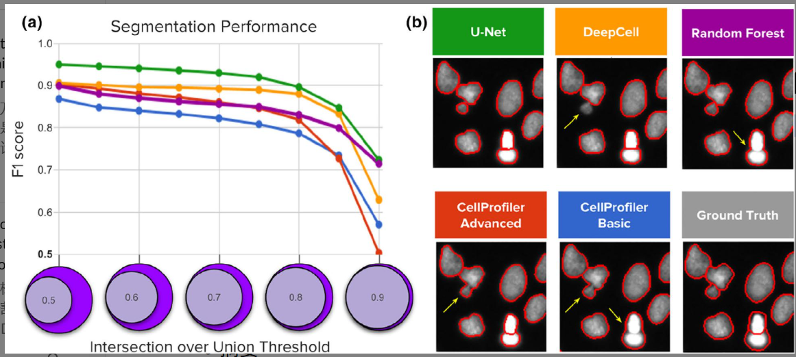
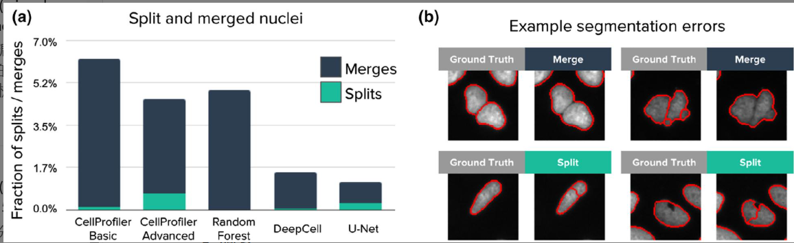

# 论文阅读笔记：荧光图像中细胞核分割的深度学习策略评估

## 1. 基本信息

- **标题：** Evaluation of Deep Learning Strategies for Nucleus Segmentation in Fluorescence Images 
- **作者：** Juan C. Caicedo, Anne E. Carpenter 等（来自 Broad Institute of MIT and Harvard）
- **年份 / 会议：** 2019 / *Cytometry Part A*
- **关键词：** 荧光成像 (Fluorescence imaging)、深度学习 (Deep learning)、细胞核分割 (Nuclear segmentation)、高通量筛选 (Chemical screen)

### 一句话总结
这篇论文主要解决了**传统分割指标无法准确衡量生物学误差**的问题，提出了**一套基于对象级（Object-level）的评估框架**，并对比了深度学习与传统方法的优劣，最终实现了**深度学习能将生物学相关误差减少一半**的结论。

---

## 2. 研究背景与问题

### 背景
细胞核分割是细胞图像分析的关键第一步。准确的分割对于药物筛选、表型分析和基因扰动研究至关重要。随着高通量成像技术的发展，每天会产生 TB 级的数据，亟需自动化且鲁棒的工具。

### 现有方法的问题
1.  **评估指标脱节：** 传统的 Jaccard 指数等像素级指标无法区分“边界稍微偏离”与“物体丢失或合并”这两种性质完全不同的错误。
2.  **鲁棒性不足：** 经典算法（如 Otsu + Watershed）依赖于双峰分布或清晰边界的假设，在复杂表型或噪声环境下容易失效。
3.  **配置繁琐：** 传统工具需要专家手动调整大量参数以适应特定实验。

### 论文要解决的问题
1.  建立一套能反映生物学意义误差（如漏检、合并、分裂）的评估体系。
2.  定量比较深度学习（U-Net, DeepCell）与传统方法（CellProfiler, Ilastik）在细胞核分割上的表现。
3.  探讨训练数据量、图像质量对模型泛化能力的影响。

---

## 3. 核心方法

### 核心思想
论文将细胞核分割视为一个**三类像素分类问题**（背景、内部、边界）。通过引入边界类，强制模型学习区分相互接触的物体。在评估阶段，放弃单一的像素重叠率，采用**基于 IoU 阈值的对象级 F1-score**。

### 方法流程
**数据标注**（专家手工标注 2.3 万个细胞核）  
↓  
**问题转化**（将实例分割掩码转化为背景/内部/边界三色图）  
↓  
**模型训练**（训练 U-Net 和 DeepCell，使用数据增强应对小样本）  
↓  
**后处理**（利用预测的内部和边界概率图，通过连通域分析恢复个体实例）  
↓  
**多维度评估**（计算不同 IoU 阈值下的 F1-score，并分类统计错误类型）  

### 与已有方法的区别
相比于传统的**阈值分割法（Otsu）**或**基于特征工程的机器学习（Random Forest）**，深度学习方法能够自动提取深层空间特征，且通过 **加权损失函数（如给边界像素 10 倍权重）** 显著解决了“细胞粘连（Merging）”这一顽疾。

---

## 4. 实验

### 实验环境
- **数据集：** BBBC039（200 幅 U2OS 细胞图像，包含 23,165 个标注核）。
- **硬件：** NVIDIA Titan X GPU。
- **Baseline：** CellProfiler (Basic/Advanced), Ilastik (Random Forest)。
- **主要指标：** Object-level F1-score, Merge/Split error counts, Z'-factor (生物有效性指标)。

### 主要实验结果

| 实验 | 比较内容 | 结果 | 说明 |
|---|---|---|---|
| 分割精度 | 不同 IoU 阈值下的 F1 | U-Net (0.898) > DeepCell (0.858) > 传统方法 | 在高精度要求下，DL 优势更明显 |
| 错误类型 | 合并与分裂误差数 | DL 方法减少了约 50% 的合并错误 | DL 能更有效地识别细胞间的微弱边界 |
| 数据量影响 | 训练图数量 vs 精度 | 仅需 20 幅图即可达到性能平台 | 说明 DL 在生物图像领域具有很高的样本效率 |
| 泛化性 | 跨实验（不同噪声/亮度） | 在多样化数据集上训练的模型泛化更好 | 信号质量的异质性是模型迁移的最大挑战 |

### 最重要的图
**Figure 2 (Performance Curves) 与 Figure 4 (Error Analysis)**
 
 
- **图说明：** Figure 2a 展示了随着 IoU 阈值提高（要求越来越严格），U-Net 的 F1-score 下降最慢；Figure 4 展示了 DL 方法在减少“Merge”错误上的卓越表现。
- **我的理解：** 深度学习的优势不仅在于“分得准”，更在于“分得开”。它学习到了细胞核边缘的抽象模式，而不只是简单的亮度跳变。

---

## 5. 论文贡献

1.  **贡献了高质量数据集：** 公布了 BBBC039 数据集，包含 2.3 万个专家标注的细胞核，成为该领域的基准。
2.  **提出了评估框架：** 建立了对象级误差分析方法，能定量区分漏检、合并和分裂。
3.  **验证了 DL 的优越性：** 证明了即便在小样本下，经过良好设计的 CNN 也能大幅超越传统成熟工具。

**最重要的是：** 揭示了 **“边界学习”** 在生物实例分割中的核心作用。  
**原因：** 生物图像中最大的痛点是细胞堆叠和粘连，通过将边界设为独立类别并加权，解决了传统方法最难处理的拓扑分离问题。

---

## 6. ⭐ 我的思考

### 我觉得做得好的地方
- 实验设计极其严谨，不仅比精度，还比**计算效率（GPU vs CPU）**和**标注成本**，这对实际实验室部署非常有参考价值。
- 引入了 Z'-factor，将算法性能直接与生物筛选的统计效能挂钩。

### 我觉得存在的问题
- 对于**微小细胞核（Micronuclei）**，所有方法表现都不好。论文未提出专门针对极小目标的检测机制。
- 后处理依然依赖于传统的连通域算法，没有实现端到端的实例分割（如 Mask R-CNN）。

### 为什么这个方法有效？
- **空间上下文：** CNN 的感受野（U-Net 为 256x256）远大于传统算子的局部窗口，能利用全局信息判断模糊边缘。
- **非线性建模：** 能够处理亮度极度不均和非双峰分布的复杂背景。

### 如果让我改进
1.  **尝试端到端模型：** 使用 Mask R-CNN 或 StarDist，减少后处理对形态学算子的依赖。

---

## 7. 可迁移 / 可复用 / 可组合点

### 7.1 可迁移的框架或思路
- **“三类像素分类”建模：** 将物体边缘作为独立类别进行预测，并给予更高损失权重。这可以迁移到任何**密集接触物体的分割任务**（如钢珠计数、木材堆叠分割）。

### 7.2 可复用的模块 / 组件
- **对象级评估脚本：** 论文提供的计算不同 IoU 下 F1-score 的代码非常适合复用到其他工业质检项目。

### 7.3 可与其他文章组合的点
- **组合 StarDist：** 可以将本文的边界预测思路与 StarDist（基于星型多边形的分割）结合，进一步提升对非圆形细胞核的鲁棒性。

---

## 8. 总结

### 这篇论文解决了什么？
- 解决了荧光图像分割中传统方法难处理细胞粘连、评估指标不贴合生物实际需求的问题。

### 怎么解决的？
- 通过对比 U-Net/DeepCell 与传统方法，并提出一套基于对象级 F1-score 的评估框架。

### 对我有什么启发？
- **标注质量胜过数量：** 20 张高质量标注图就能让 DL 表现优异。
- **关注边界：** 分割任务的核心往往在于对边缘的特殊处理。

### 是否值得复现？
**是。** 其提供的 BBBC039 数据集和三分类 U-Net 框架是进入生物医学图像处理领域的绝佳基准（Baseline）。