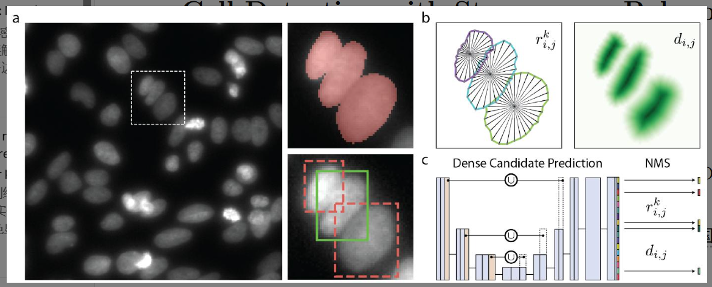

# 论文阅读笔记

## 1. 基本信息

- **标题：** Cell Detection with Star-convex Polygons
- **作者：** Uwe Schmidt, Martin Weigert, Coleman Broaddus, Gene Myers
- **年份 / 会议：** 2018 / MICCAI (Medical Image Computing and Computer Assisted Intervention)
- **关键词：** Star-convex Polygons, Cell Detection, Instance Segmentation, StarDist, U-Net

### 一句话总结

这篇论文主要解决了**高密度拥挤场景下细胞核检测与分割难以区分个体**的问题，提出了 **StarDist** 方法（利用星形凸多边形表征物体），最终实现了**无需复杂后处理即可精准分离触碰细胞**的效果。

---

## 2. 研究背景与问题

### 背景
在生物医学影像分析中，自动检测和分割细胞核是后续表型分析、细胞谱系追踪等任务的基础。由于细胞通常呈圆形或椭圆形，且分布密集，准确的实例分割至关重要。

### 现有方法的问题
1.  **自底向上 (Bottom-up) 方法：** 先进行语义分割（像素分类），再通过连通域分析区分个体。在细胞拥挤时，哪怕只有几个像素分类错误，也会导致相邻细胞被错误地合并。
2.  **自顶向下 (Top-down) 方法：** 如 Mask R-CNN，通常预测轴向对齐的候选框（Bounding Box）。当细胞斜向排列且靠得很近时，候选框重叠度极高，非极大值抑制 (NMS) 容易误删真实的细胞实例。

### 论文要解决的问题
作者试图寻找一种比“像素集合”更鲁棒、比“轴向框”更精确的几何表征方式，以解决高密度场景下的实例粘连和误删问题。

---

## 3. 核心方法

### 核心思想
放弃使用矩形框，改为预测**星形凸多边形 (Star-convex Polygons)**。对于图像中的每个像素，模型预测两个值：
1.  该像素属于某个物体的**概率**。
2.  如果属于物体，预测从该像素出发，沿 $n$ 个等角度径向方向到达物体边界的**距离**。

### 方法流程
输入图像  
↓  
**U-Net 骨干网络提取特征**  
↓  
**双分支输出层：** 1. 概率图（Probability Map）；2. 径向距离图（$n$ 个通道的 Radial Distances）  
↓  
**多边形生成：** 对概率高于阈值的像素，根据预测的距离生成多边形顶点  
↓  
**多边形 NMS：** 基于多边形重叠度剔除冗余提案  
↓  
得到最终的细胞实例分割结果

### 与已有方法的区别
相比于传统的 **Mask R-CNN**（预测矩形框 + 掩码），StarDist 的最大改变是**将形状先验（星形凸性）直接融入参数化回归中**。它不依赖候选框，而是直接回归几何距离，这使得它在处理圆形物体时比矩形框更紧凑，能更有效地区分紧挨着的个体。

---

## 4. 实验

### 实验环境
- **数据集：** Toy（合成椭圆）、TRAgen（模拟细胞群体）、DSB2018（2018 Data Science Bowl 真实荧光显微镜图像）。
- **Baseline：** U-Net (2 class), U-Net (3 class, 含边界类), Mask R-CNN。
- **主要指标：** Average Precision (AP) at various IoU thresholds.

### 主要实验结果

| 实验 | 比较内容 | 结果 | 说明 |
|---|---|---|---|
| Toy 数据集 | 轴向框 vs 多边形 | StarDist 远优于 Mask R-CNN | 证明了矩形框在处理斜向触碰物体时的局限性。 |
| TRAgen | 拥挤场景性能 | StarDist 与 U-Net(3 class) 领先 | 证明了该方法在极度拥挤（细胞融合风险高）时的鲁棒性。 |
| DSB2018 | 真实场景泛化 | StarDist 在多数 IoU 阈值下表现最优 | 说明方法在真实、复杂的显微场景中具有极高的实用价值。 |

### 最重要的图
**Figure 1 (a) & (b)**

- **这张图说明：** (a) 展示了传统方法的两种失败模式：连通域合并（Merging）和 NMS 误删（Suppression）；(b) 展示了 StarDist 如何通过中心向外的径向距离来定义形状。
- **我的理解：** 这是全书的“灵魂”。它直观地解释了为什么“形状表征”的选择决定了检测的上限。

---

## 5. 论文贡献

我认为主要有：
1.  提出了一种**参数化的星形凸多边形表征**，非常契合生物细胞的几何特性。
2.  设计了一个简洁的端到端网络架构，将**距离回归与中心概率预测**结合。
3.  通过实验证明了在**高密度、高重叠场景下**，几何先验比单纯的像素分类或矩形框检测更有效。

**其中最重要的是：** 引入星形凸性先验（Star-convex prior）。
**原因：** 它在“过于灵活的像素分类”和“过于僵硬的矩形框”之间找到了一个完美的平衡点，既保留了形状约束，又具备足够的描述力。

---

## 6. ⭐ 我的思考

### 我觉得做得好的地方
- 巧妙地利用了**中心距离图**。由于中心点的预测通常比边缘像素更准确，这种设计天然地增加了模型对噪声和模糊边缘的抵抗力。
- 概率图采用了**到背景的欧几里得距离归一化**，这让 NMS 自动倾向于选择靠近细胞中心的提案，极大地提高了中心定位的稳定性。

### 我觉得存在的问题
- **形状限制：** 只能处理星形凸物体。如果细胞是长条形、弯曲的（如某些细菌或神经元），该方法会失效。
- **径向采样率：** $n$ 的取值（文中用 32）是一个权衡，对于边缘极其复杂的物体，32 个点可能导致形状过于平滑。

### 我没看懂 / 有疑问的地方
- 对于完全重叠（一个大细胞叠在一个小细胞上）的情况，StarDist 是否能区分？因为每个像素只预测一个物体实例。

### 为什么这个方法有效？
它利用了**全局几何约束**。传统的语义分割只看局部像素特征，容易受局部噪声干扰而断开或合并；而 StarDist 预测的是“一组向外生长的射线”，这要求模型从全局上理解物体的尺度和中心，这种结构化的输出比孤立的像素预测更难出错。

---

## 7. 可迁移 / 可复用 / 可组合点

### 7.1 可迁移的框架或思路
- **径向回归思路：** 这种从中心向边缘回归距离的方法可以迁移到任何**中心对称或类圆物体的检测**中（如工业质检中的螺栓、水果检测等）。

### 7.2 可复用的模块 / 组件
- **加权损失函数：** 训练时使用概率图作为距离损失的权重，让背景不参与距离计算，这个 Trick 在处理回归任务时非常实用。

### 7.3 可与其他文章组合的点
- **与跟踪算法组合：** 论文提到 StarDist 预测的完整形状（即使部分遮挡也能预测出圆润形状）非常适合作为多目标跟踪（MOT）的输入，可以补偿遮挡导致的漏检。

### 一句话迁移结论
这篇文章最值得迁移的是**利用径向距离表征类圆物体的思路**，最适合迁移到**目标分布密集且形状相对规则的工业或医学影像检测**问题。

---

## 8. 总结

### 这篇论文解决了什么？
解决了高密度场景下，传统分割方法易合并、检测方法易误删细胞的问题。

### 怎么解决的？
通过 U-Net 同时预测每个像素的物体概率和 32 个方向的径向边界距离，用多边形代替矩形框。

### 效果怎么样？
在标准生物影像数据集上达到了 SOTA，尤其在处理“触碰”和“斜向排列”的细胞时表现极佳。

### 对我有什么启发？
有时候改变**数据的表示方式 (Representation)** 比单纯堆叠深度模型架构更有效。物理/几何先验的引入能显著降低对后处理的依赖。

### 是否值得复现？
**是。** 代码开源且架构清晰，是生物图像处理领域的经典 Baseline。