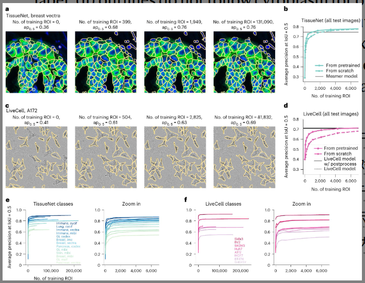

# 论文阅读笔记

## 1. 基本信息

- **标题**：Cellpose 2.0: how to train your own model
- **作者**：Marius Pachitariu & Carsen Stringer
- **年份 / 会议**：2022 / Nature Methods
- **关键词**：Cell segmentation, Human-in-the-loop, Deep learning, Fine-tuning, Bioimage analysis

### 一句话总结
这篇论文主要解决了**生物图像分割模型在面对新图像类型时泛化性不足及标注成本高昂**的问题，提出了 **Cellpose 2.0 软件套件（包含模型动物园和人机耦合流水线）**，最终实现了**仅需 100-200 个 ROI 标注即可在 1-2 小时内训练出达到人类专家水平的定制化分割模型**的效果。

---

## 2. 研究背景与问题

### 背景
生物图像具有极高的多样性（组织类型、显微技术、荧光标记各异）。虽然已有如 Cellpose 1.0 的通用模型，但生物学研究往往需要极高的精确度，且不同实验室的标注风格（Style）存在显著差异。

### 现有方法的问题
1. **泛化瓶颈**：神经网络难以处理与训练集分布不一致（Out-of-distribution）的新数据。
2. **标注成本**：如 TissueNet 等大型数据集需要数年的标注工作量，普通研究者无法承受。
3. **风格冲突**：单一全局模型无法同时满足多种标注偏好（例如：是否包含细胞核、边界是否向外扩张）。

### 论文要解决的问题
如何让非深度学习专家能以极小的标注代价（少量图像、极短时间），训练出适配特定实验需求的、高质量的专用分割模型？

---

## 3. 核心方法

### 核心思想
Cellpose 2.0 放弃了“一个模型包打天下”的幻想，转而采用 **“预训练 + 风格化选择 + 迭代式精调”** 的策略。通过构建模型动物园（Model Zoo）提供良好的起点，并利用人机耦合（Human-in-the-loop）将人类的纠错转化为有效的训练样本。

### 方法流程
1. **输入新图像**：用户提供少量待分割的特殊生物图像。
2. **风格识别**：利用卷积网络提取“风格向量（Style Vector）”，在模型动物园中匹配最接近的模型。
3. **人机耦合迭代**：
   - 模型给出初步分割。
   - 用户在 GUI 中仅修正错误（增加漏选、删除误选）。
   - 模型基于修正后的数据进行快速精调（Fine-tuning）。
4. **得到结果**：循环 3-5 张图像后，得到高性能定制模型。

### 与已有方法的区别
相比于**传统通用模型（如 Cellpose 1.0, StarDist）**或**从头训练（Training from scratch）**的**最大改变**：引入了**交互式训练**。传统方法是“标注-训练-评估”的离线线性过程，Cellpose 2.0 是“预测-纠错-实时再训练”的闭环，且证明了预训练模型在大规模多样化数据集（Cellpose dataset）上学习到的特征可以极大地加速小样本下的收敛。

---

## 4. 实验

### 实验环境
- **数据集**：TissueNet (13类), LiveCell (8类), Cellpose dataset。
- **Baseline**：Cellpose 1.0 (Generalist), Mesmer (TissueNet 专用), LiveCell model (专用)。
- **主要指标**：平均精度 (Average Precision, AP)，特别是在 IoU=0.5 阈值下。

### 主要实验结果

| 实验 | 比较内容 | 结果 | 说明 |
|---|---|---|---|
| **精调 vs 从头训练** | 在 TissueNet 上使用不同数量 ROI 训练 | 预训练模型在 500 ROI 时的 AP 远超从头训练 | 证明了 Cellpose 预训练权重的强大迁移能力 |
| **模型动物园效果** | 9个风格化子模型 vs 单一模型 | 子模型在各自类别上 AP 提升 0.01-0.06 | 证明了针对特定风格建模的必要性 |
| **人机耦合效率** | 在线纠错 vs 离线完全标注 | 仅需 100-200 ROI 即可达到 600+ ROI 的效果 | 纠错比重新标注更有信息量，且速度快 3-5 倍 |

### 最重要的图
**Figure 3 (State-of-the-art cellular segmentation does not require big data)**

- **这张图说明**：随着标注 ROI 数量的增加，模型性能的提升曲线。
- **我的理解**：该图展示了“边际效用递减”。在拥有 Cellpose 预训练权重的前提下，曲线在极早期（ROI < 1000）就出现了陡峭上升并迅速进入平台期。这有力地反驳了“必须有海量数据才能用深度学习”的偏见。

---

## 5. 论文贡献

我认为主要有：
1. **提出了高效的人机耦合流程**：将标注压力从“画圈”转变为“改错”，极大地降低了算法落地门槛。
2. **建立了生物图像模型动物园**：通过聚类风格向量，解决了标注风格冲突的问题。
3. **验证了多样性优于规模**：证明了在较小但更多样化的数据集上预训练，比在巨大但单一的数据集上效果更好。

**其中最重要的是：人机耦合迭代精调机制。**
**原因**：它真正解决了学术研究到实际科研应用的最后一步——即便算法再好，如果用户需要标注一个月才能用，那这个算法就是失败的。它将“月”级的工作量缩短到了“小时”级。

---

## 6. ⭐ 我的思考

### 我觉得做得好的地方

- **直面“风格差异”**：承认生物图像标注没有绝对真理，尊重用户的标注习惯。

### 我觉得存在的问题
- **算力依赖**：虽然精调快，但在低端 CPU 上运行“人机耦合”循环仍有延迟，限制了硬件普及性。
- **过拟合风险**：在极小样本（3-5张图）上精调，可能会导致模型在处理该批次外稍微波动的图像时失效。

### 我没看懂 / 有疑问的地方
- **风格向量的鲁棒性**：如果图像噪声极大，提取的风格向量是否会发生偏移，导致自动推荐了错误的子模型？

### 为什么这个方法有效？
**底层原理**：迁移学习（Transfer Learning）。深度卷积网络的前几层学习的是通用的边缘、纹理特征。Cellpose 在 500+ 张极其多样的图像上预训练，已经掌握了“什么是细胞轮廓”的通用物理特征。用户精调过程本质上是在调整最后几层参数，以适配特定的“色彩增益、对比度或边界定义准则”。

---

## 7. 可迁移 / 可复用 / 可组合点

### 7.1 可迁移的框架或思路
- **“风格向量”聚类思路**：在处理医疗影像、缺陷检测等领域时，如果不同客户的标注标准不一，可以先用聚类识别“风格”，再进行分支建模。

### 7.2 可复用的模块 / 组件
- **AP 计算评估脚本**：其针对生物图像定义的平均精度评估逻辑非常严谨。

### 7.3 可与其他文章组合的点
- **与 SAM (Segment Anything Model) 结合**：利用 SAM 的强提示能力进行第一轮粗分割，再用 Cellpose 进行精细化的生物学约束分割。

### 一句话迁移结论
这篇文章最值得迁移的是**人机耦合的迭代精调思路**，最适合迁移到**样本稀缺且专家标注成本极高的医疗影像分割**问题。

---

## 8. 总结

### 这篇论文解决了什么？
解决了生物图像分割中“通用模型不精准、专用模型标注难”的矛盾。

### 怎么解决的？
通过预训练权重的迁移学习，结合一个允许用户快速纠错并实时重训练模型的 GUI 系统。

### 效果怎么样？
仅需 1-2 小时手工工作，即可获得在特定数据集上达到 SOTA 水平的定制模型。

### 对我有什么启发？
**数据质量和多样性远比数量重要。** 在垂直领域，与其追求“大而全”的单一模型，不如追求“小而美”的快速适配能力。

### 是否值得复现？
**是。** 其工程实现思路（尤其是实时精调的超参数设置）对开发交互式 AI 工具极具参考价值。