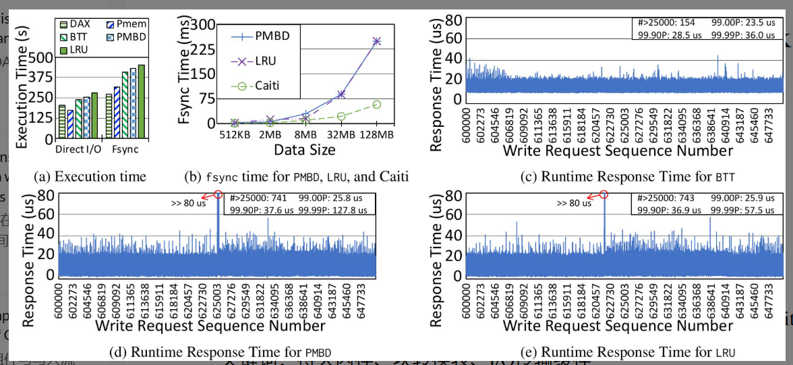
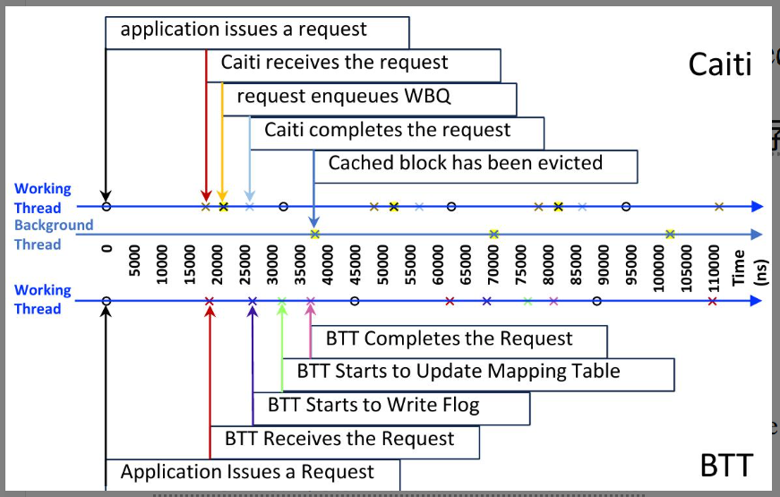

# 论文阅读笔记

## 1. 基本信息

- **标题:** I/O Transit Caching for PMem-based Block Device (面向基于 PMem 块设备的 I/O 中转缓存)
- **作者:** Qing Xu, Qisheng Jiang, Chundong Wang
- **年份 / 会议:** 2024 / Journal of Systems Architecture (JSA)
- **关键词:** Persistent Memory (PMem), Block Translation Table (BTT), I/O Transit Caching, Write Atomicity

### 一句话总结
这篇论文主要解决了 **基于 PMem 的块设备（如 BTT）因维护块级写入原子性而导致性能严重下降** 的问题，提出了 **Caiti（一种 I/O 中转缓存算法）** 方法，最终实现了 **在保持块级写入原子性的同时，将 BTT 的性能提升了高达 3.6 倍** 的效果。

---

## 2. 研究背景与问题

### 背景
非易失性内存（PMem）具有接近 DRAM 的低延迟和字节寻址能力。然而，许多传统应用（如数据库）依赖于块设备的“块级写入原子性”（即 4KB 写入要么全部成功，要么全部失败）。为了兼容性，Intel 提出了 **BTT (Block Translation Table)** 驱动，通过写时复制 (CoW) 和日志机制在 PMem 上模拟具有原子性保证的块设备。

### 现有方法的问题
1. **软件开销巨大：** BTT 维护原子性的机制（CoW + Logging）引入了显著的延迟，导致性能远低于原始 PMem 访问。
2. **传统缓存失效：** 作者尝试将传统的 DRAM 缓存（如 LRU 或 PMBD 策略）加入 BTT，发现性能反而下降了 6% - 15.1%。这是因为 PMem 速度极快，传统缓存由于“写满后同步冲洗”产生的 I/O 停顿（Stall）成了新的瓶颈。
3. **关键组件缺失：** 传统磁盘有内部硬件缓存，而 BTT 作为一个软件驱动，缺乏针对 PMem 特性优化的缓存层。

### 论文要解决的问题
如何在不牺牲块级写入原子性的前提下，设计一种能消除 BTT 软件开销、避免 I/O 停顿、并能充分利用多核 CPU 性能的 PMem 块设备缓存系统？

---

## 3. 核心方法

### 核心思想
作者提出了 **I/O Transit Caching（中转缓存）** 概念。不同于传统缓存试图长时间保留数据以提高命中率，**Caiti 将 DRAM 缓存视为一个“极速中转站”**。它的目标是让数据尽可能快地进入 DRAM（前端），然后立即由后台线程异步“搬运”到 PMem（后端），从而掩盖 BTT 的原子性维护开销。

### 方法流程

**问题：** BTT 原子性写入慢，传统缓存因 Flush 导致严重停顿。  
↓  
**分析：** 停顿源于缓存空间被填满以及 `fsync` 时的集中写入。  
↓  
**提出方法：** Caiti 算法。  
↓  
**具体实现：** 
1. **急切逐出 (Eager Eviction)：** 只要数据入队，立即启动后台线程写入 PMem，不等待缓存满。
2. **条件旁路 (Conditional Bypass)：** 如果缓存真满了，直接写 PMem，不让前端请求在关键路径上等待空间释放。
3. **多队列与哈希管理：** 消除全局锁，利用多核并行处理 I/O。  

↓  
**得到结果：** 极低的 tail latency（尾部延迟），性能接近甚至超过 Raw PMem。

### 与已有方法的区别
- **从“存储”变“中转”：** 传统方法（LRU/PMBD）是“被动”清理空间，Caiti 是“主动”清空空间。
- **旁路机制：** 传统缓存在满时会阻塞 I/O，Caiti 在满时选择“绕行”直达 PMem，保证了响应时间的确定性。

---

## 4. 实验

### 实验环境
- **数据集 / Workload:** Fio (Random Write), LevelDB (Fillrandom, Overwrite), Filebench.
- **硬件 / 模拟器:** Intel Optane DC Persistent Memory (768GB), 36-core Xeon Gold CPU.
- **Baseline:** 原生 BTT, Ext4-DAX, PMBD 缓存, LRU 缓存, Co-Active (COA).
- **主要指标:** Execution Time (s), Average Response Time (μs), Throughput (MB/s), Tail Latency (99.99P).

### 主要实验结果

| 实验 | 比较内容 | 结果 | 说明 |
|---|---|---|---|
| **Fio 随机写** | Caiti vs. 原生 BTT | 提升达 3.6x | 成功掩盖了 BTT 的 CoW/Logging 开销。 |
| **Tail Latency** | Caiti vs. PMBD/LRU | 显著降低 | 避免了传统缓存在 Flush 时的长尾延迟（Spikes）。 |
| **LevelDB** | 吞吐量比较 | 提升 17.8% - 48.8% | 在真实 KV 存储应用中展现出更强的处理批量 `fsync` 的能力。 |

### 最重要的图
**Figure 2 (a-e) 以及 Figure 7 (Timeline)**
  
  
- **这张图说明：** Figure 2 显示了传统缓存（PMBD/LRU）在运行过程中会有密集的延迟毛刺（Spikes），而 Caiti 非常平滑。Figure 7 展示了 Caiti 的后台线程如何在前端请求完成前就开始了“搬运”工作。
- **我的理解：** Caiti 实际上是利用了“前后台流水线”的设计。它利用 DRAM 的极高性能作为缓冲区，给 BTT 争取了处理原子性逻辑的时间，使得从用户视角看，写入延迟几乎等同于 DRAM。

---

## 5. 论文贡献

1. **揭示了矛盾：** 定量分析并指出了在极速 PMem 设备上使用传统 I/O 缓存策略反而会导致性能下降的原因。
2. **提出 Caiti 算法：** 设计了“急切逐出”和“条件旁路”两大核心策略，实现了“中转缓存”模式。
3. **高性能实现：** 充分利用多核 CPU 和多队列技术，解决了缓存管理中的锁竞争问题。

**最重要的是：** 提出了**中转缓存 (Transit Caching)** 这一设计范式。
**原因：** 它打破了传统存储架构中“缓存是为了重用数据”的固有思维，针对“超高速后端”提出了“缓存是为了平滑写入开销”的新思路，这对未来基于 CXL 等技术的超高速存储系统设计极具参考价值。

---

## 6. ⭐ 我的思考

### 我觉得做得好的地方
- **动机明确：** 并不是为了刷榜而做实验，而是先观察到“加了缓存反而变慢”这个反直觉现象，进而深入分析。
- **简单有效：** 并没有使用复杂的机器学习预测，而是通过改善 I/O 路径上的并发和旁路逻辑解决问题，这种设计更具工业实用性。

### 我觉得存在的问题
- **读取加速有限：** 论文重点在于写入优化。由于“急切逐出”，数据在 DRAM 中驻留时间很短，如果应用有极高的“刚写完就读”的需求，Caiti 可能会因为缓存未命中（已经刷入 PMem）而导致读取性能不如传统缓存。

### 我没看懂 / 有疑问的地方
- 在 **Conditional Bypass** 触发时，如果直接写入 PMem，此时如何保证与 BTT 内部状态的一致性？（虽然论文提到了保持原子性，但在缓存和 BTT 驱动两层之间的数据同步细节可以更深入探讨）。

### 为什么这个方法有效?
从原理上讲，它实现了 **I/O 请求的解耦**。它利用 DRAM 和多核 CPU 的并行能力，将同步的块设备操作转化为异步操作。由于 PMem 的带宽和延迟与 DRAM 处于同一个数量级，这种“中转”产生的积压风险极低，从而能持续提供高性能。

### 如果让我改进
1. **感知负载的逐出：** 目前是“急切逐出”，可以引入一个轻量级的热度检测，如果某些块被频繁改写，可以稍微多留一会儿，减少对 PMem 的写入放大。
2. **结合 CXL 协议：** 考虑在 CXL 类型设备上实现这种中转逻辑。

### 我还想做什么实验?
- **写入放大测试：** 测试这种急切逐出策略相比传统缓存，对 PMem 寿命（写入次数）的具体影响。
- **混合负载压力测试：** 在高负载 Read/Write 混合场景下，观察 Caiti 的表现。

---

## 7. 总结

- **这篇论文解决了什么?** 解决了 PMem 块设备（BTT）在维护数据原子性时性能差，且传统缓存策略失效的问题。
- **怎么解决的?** 提出了 Caiti 算法，通过“急切逐出”掩盖写入延迟，通过“条件旁路”消除缓存拥塞。
- **效果怎么样?** 性能提升高达 3.6 倍，且在真实应用场景（LevelDB, Virtual Machine）中表现出极佳的稳定性。
- **对我有什么启发?** 高速硬件环境下，软件协议栈往往是瓶颈。缓存的设计不应只关注“命中率”，更应关注“路径疏导”和“消除停顿”。