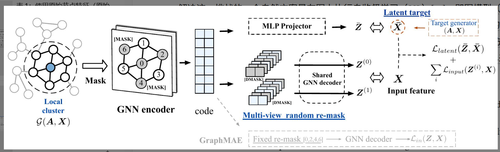

# 论文阅读笔记

## 1. 基本信息

- **标题**: GraphMAE2: A Decoding-Enhanced Masked Self-Supervised Graph Learner (GraphMAE2: 一种基于解码增强的掩码自监督图学习器)
- **作者**: Zhenyu Hou, Yufei He, Yukuo Cen, Xiao Liu, Yuxiao Dong, Evgeny Kharlamov, Jie Tang
- **年份 / 会议**: 2023 / WWW '23 (The ACM Web Conference)
- **关键词**: 图神经网络 (GNN); 自监督学习 (SSL); 掩码图建模 (MGM); 预训练

### 一句话总结
这篇论文主要解决了**掩码图自编码器在重构时过度依赖节点特征区分度且易受噪声干扰**的问题，提出了**GraphMAE2**框架，通过**多视角随机重掩码解码**和**潜在表示预测**两种增强解码策略，在包括亿级节点（ogbn-Papers100M）在内的多个数据集上实现了最先进的自监督学习效果。

## 2. 研究背景与问题

### 背景
图神经网络（GNN）在有监督设置下取得了巨大成功，但现实中获取大规模图数据的标签成本极高。自监督学习（SSL），特别是生成式的掩码图建模（MGM），通过让模型通过部分观察到的数据来预测被掩码（Masked）的部分，展现出了无需人工标签即可学习强大表征的潜力。

### 现有方法的问题
以 GraphMAE 为代表的现有方法主要通过重构节点特征来实现。
1. **依赖特征区分度**：掩码特征重构的效果高度依赖于输入特征本身的质量。如果节点特征区分度低（如社交网络中的大致描述），重构任务会变得模糊。
2. **易受干扰**：当输入特征包含噪声或通过降维（如 PCA）处理后，现有模型的性能会大幅下降，甚至不如有监督模型稳健。
3. **解码策略单一**：现有的固定重掩码（Fixed re-mask）解码方式限制了模型的正则化能力，容易导致对原始特征的过拟合。

### 论文要解决的问题
作者旨在通过引入更强大的**正则化约束**到解码阶段，提高模型对低区分度特征和噪声的鲁棒性，并提升在大规模图上的可扩展性。

## 3. 核心方法

### 核心思想
GraphMAE2 的核心逻辑是“**强化解码器的任务难度，提供更丰富的监督信号**”。它不再仅仅死磕“根据 A 还原 A”，而是引入了随机性来防止过拟合，并引入了“潜在空间”的预测任务来提供比原始特征更高级的监督。

### 方法流程

**问题**：特征重构易过拟合且受特征质量限制。  
↓  
**分析**：解码阶段需要更强的正则化和除原始特征外的辅助目标。  
↓  
**提出方法**：GraphMAE2 框架。  
↓  
**具体实现**：
1. **多视角随机重掩码解码**：在解码前对编码后的表示进行多次随机掩码，强制解码器从不同的受损视图中恢复特征。
2. **潜在表示预测**：引入一个目标生成器（EMA 更新），让模型在嵌入空间中预测未掩码节点的特征。
3. **局部聚类采样**：针对大规模图，使用 PPR-Nibble 采样密集子图。  
   
↓  
**得到结果**：在多个规模的数据集上打破 SOTA 纪录。

### 与已有方法的区别
相比 GraphMAE，最大的改变在于：
- **从“固定”到“随机”**：解码时的重掩码由固定变为多次随机（Multi-view），大幅增强了正则化。
- **从“特征空间”扩展到“潜在空间”**：不再只预测原始像素/词袋，还预测经过模型加工的高层语义表示（Latent representation）。

## 4. 实验

### 实验环境
- **数据集 / Workload**: Cora, CiteSeer, PubMed (小规模); ogbn-Arxiv, ogbn-Products, MAG-Scholar-F, ogbn-Papers100M (大规模)。
- **硬件 / 模拟器**: 8x NVIDIA A100 (80GB), 1007GB RAM。
- **Baseline**: 有监督 GAT/GCN, CCA-SSG, GRACE, BGRL, GraphMAE 等。
- **主要指标**: 分类准确率 (Accuracy %)。

### 主要实验结果

| 实验 | 比较内容 | 结果 | 说明 |
|---|---|---|---|
| **线性探测** | GraphMAE2 vs. Baselines | **SOTA** | 在所有大规模数据集上均排名第一，显著优于对比学习方法。 |
| **特征敏感性** | 原始特征 vs. PCA 特征 | **下降更小** | 在 PCA 降维后的低质量特征下，GraphMAE2 的性能下降远小于 GraphMAE。 |
| **消融实验** | 移除各组件 | **性能均下降** | 潜在表示预测（Latent Pred）对性能提升贡献最大。 |
| **大规模扩展** | 1.1 亿节点数据集 | **提升 2.45%** | 在 Papers100M 上相较于最强基线有显著提升。 |

### 最重要的图
**Figure 2: Overview of GraphMAE2 framework.**

这张图说明了模型的双支路解码结构：下方支路负责通过“多视角随机重掩码”重构输入特征 $X$；上方支路通过 MLP Projector 预测由目标生成器产生的“潜在目标” $\bar{X}$。

**我的理解**：这实际上是一种“混合式自监督”，结合了生成式（重构原始输入）和判别式/蒸馏式（预测高层表示）的优点。

## 5. 论文贡献

主要有:
1. **揭示了掩码图学习对特征区分度的敏感性**：通过 PCA 实验有力地证明了现有生成式方法的短板。
2. **设计了两种创新的解码增强策略**：多视角随机重掩码和潜在表示预测，为图 SSL 提供了新的正则化范式。
3. **实现了超大规模图的有效处理**：通过局部聚类采样策略，使模型能够处理十亿级边规模的图。

**其中最重要的是：潜在表示预测（Latent Representation Prediction）任务的引入。**  
**原因**：它打破了“重构必须基于原始特征”的局限，利用 EMA 更新的目标生成器提供了更平滑、包含更高层语义的监督信号，有效缓解了输入特征噪声带来的负面影响。

## 6. ⭐ 我的思考

### 我觉得做得好的地方
- **动机清晰**：作者不是盲目叠加模块，而是先通过实验（Table 1 的 PCA 实验）证明了 GraphMAE 的痛点，再针对性提出方案。
- **扩展性强**：在 Papers100M 这种超大规模数据集上跑出自监督的优越性，非常具有工业参考价值。

### 我觉得存在的问题
- **计算开销**：多视角随机重掩码意味着解码器需要运行 $K$ 次（实验中 $K=3$），虽然解码器很轻量（单层 GAT），但在超大规模图上仍会增加训练耗时。
- **超参数敏感性**：系数 $\lambda$ 在不同数据集上跨度极大（从 0.1 到 10.0），这说明模型对重构任务和预测任务的平衡比较敏感。

### 我没看懂 / 有疑问的地方
- 在潜在表示预测中，使用 EMA 更新目标生成器。如果初始化的编码器质量很差，EMA 是否会导致模型陷入“平凡解”或崩溃？论文中提到移除特征重构支路会导致性能骤降，这是否意味着特征重构支路是防止崩溃的“锚点”？

### 为什么这个方法有效?
从原理上讲，GraphMAE2 引入了**信息瓶颈和对比约束的变体**：
1. **随机重掩码**增加了数据的变体，类似于一种隐式的图增强，提高了编码器的特征提取鲁棒性。
2. **潜在表示预测**引入了“教师-学生”机制。教师网络（EMA）提供的目标比原始带噪声的特征更稳定，促使学生网络学习更本质的结构语义而非拟合噪声。

### 优化方向：结构引导掩码＋课程调度
**参考论文：** Where to Mask: Structure-Guided Masking for Graph Masked Autoencoders，IJCAI 2024，CCF A。论文｜公开代码：StructMAE   

**为什么值得做：**
GraphMAE2的随机掩码不区分节点的结构重要性。StructMAE通过结构评分和由易到难的掩码调度，在其自身框架中验证了这种设计的有效性。它主要改变训练样本的选择，不必重写 GraphMAE2 的主体网络。

**具体实现建议：**
- 第一版采用节点度数等预定义评分，不先训练额外的掩码生成网络。
- 固定总掩码比例，训练初期使用随机掩码，之后逐渐混合结构引导采样。
- 第一轮只修改输入掩码，保持教师网络、重掩码解码和原损失不变。 
 
**关键消融：** 随机掩码、静态结构掩码、随机到结构的渐进掩码。  

**风险：** 结构重要性不等于重构难度；过度遮住关键节点可能破坏上下文，因此需要保留随机采样成分。

## 7. 总结

### 这篇论文解决了什么?
- 解决了掩码图自编码器在特征区分度低、特征有噪声时表现不佳的问题。

### 怎么解决的?
- 通过在解码阶段施加正则化：多次随机重掩码解码 + 预测高层潜在表示。

### 效果怎么样?
- 在多个基准测试中超越了对比学习和生成式方法的 SOTA，尤其在亿级规模图上表现卓越。

### 对我有什么启发?
- **不要只在输入端做文章**：解码阶段的精细设计（如增加任务难度、引入辅助目标）同样能大幅提升表征质量。
- **生成式与判别式的融合**：将重构原始数据与预测模型隐状态结合，可能是未来 SSL 的主流方向。

### 是否能复现?
**是**
**原因**：代码已开源，且该方法在 OGB 榜单上有实打实的性能提升，对于需要处理大规模无标签图数据的工程实践具有极高的参考价值。