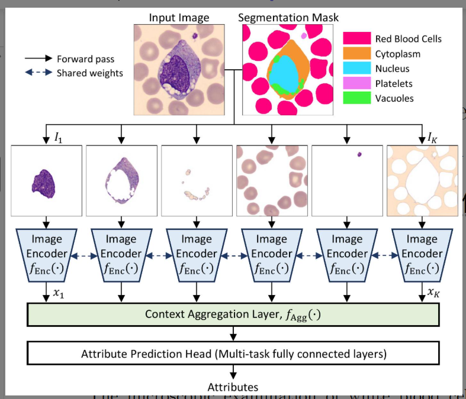

# 论文阅读笔记

## 1. 基本信息

- **标题**: WBCAtt+: Fine-Grained Pixel-Level Morphological Annotations for White Blood Cell Images
- **作者**: Satoshi Tsutsui, Winnie Pang, Shuting He, Bihan Wen
- **年份 / 会议**: 2026 (Preprint) / Medical Image Analysis (已接收)
- **关键词**: 白细胞 (WBC)、形态学属性、可解释 AI (XAI)、语义分割、数据集

### 一句话总结
这篇论文主要解决了 **白细胞识别缺乏细粒度解释性标注** 的问题，提出了 **WBCAtt+ 数据集及其配套的细胞结构感知模型**，最终实现了 **具备高度可解释性的细粒度细胞属性识别与分割** 效果。

---

## 2. 研究背景与问题

### 背景
白细胞 (WBC) 的显微镜检查是诊断白血病、贫血等血液疾病的核心手段。病理学家在识别细胞时，并非只看整体外观，而是根据特定的形态特征（如核形状、胞质颜色、是否有空泡）来做判断。

### 现有方法的问题
1. **标注粒度粗**：现有数据集（如 LISC, RaabinWBC）大多仅提供类别标签，缺乏病理学家使用的形态学特征描述。
2. **分割类别单一**：现有的分割数据集通常只区分细胞核和胞质，忽略了空泡、血小板等对诊断至关重要的微小结构。
3. **黑盒模型**：由于缺乏细粒度标注，现有的深度学习模型难以提供符合临床逻辑的解释。

### 论文要解决的问题
作者旨在建立一个大规模、包含 11 种形态学属性和 5 类像素级分割标注的数据集，并利用这些细粒度信息构建更符合人类视觉逻辑的识别模型。

---

## 3. 核心方法

### 核心思想
论文的核心在于“**结构引导识别**”。它认为识别细胞属性（如核密度）应该先定位到对应的结构（如细胞核）。为此，作者提出了 **Cell Structure-Aware Model (细胞结构感知模型)**，将图像按分割图拆解为不同组件，分别提取特征后再聚合。

### 方法流程

**缺乏细粒度解释性标注**  
↓  
**病理学家指导定义 11 种属性 & 5 类分割图**  
↓  
**构建 WBCAtt+ 数据集 (10k+ 图像, 113k 标签)**  
↓  
**设计细胞结构感知模型 (Segment → Encode → Aggregate)**  
↓  
**实现高精度属性识别与多种 XAI 应用**

### 与已有方法的区别
相比于传统直接对整图进行分类的方法，WBCAtt+ 引入了**组合性 (Compositional)** 的逻辑：它先将细胞“拆解”成核、质、空泡等部分，模仿病理学家“先看哪里，再判属性”的过程，显著提升了属性识别的准确性（尤其是细小特征）。

---

## 4. 实验

### 实验环境
- **数据集**: WBCAtt+ (基于 PBC 数据集重标注，含 10,298 张图像)。
- **硬件**: 实验涉及卷积神经网络 (ConvNeXt, ResNet) 和 Transformer (ViT, Swin)。
- **Baseline**: 标准的多任务学习模型（无分割引导）、FCN、SegFormer、Mask2Former。
- **主要指标**: mIoU (分割), Macro F1 (属性识别), Accuracy (分类)。

### 主要实验结果

| 实验 | 比较内容 | 结果 | 说明 |
|---|---|---|---|
| 分割实验 | 不同分割架构性能 | SwinT-Mask2Former 达 92.81 mIoU | 验证了细粒度分割的可行性，空泡最难分割。 |
| 属性识别 | 结构感知模型 vs 基础模型 | F1 分数从 91.62% 提升至 92.98% | 证明利用分割掩码提取特征能有效增强属性识别。 |
| 跨域验证 | 迁移至骨髓细胞/猪血液 | 表现出较好的泛化性 | 证明属性定义具有普适性，即使在不同物种/部位也有效。 |

### 最重要的图

- **这张图说明**：Figure 7 展示了模型如何将输入图与分割掩码结合，通过 $K$ 个分支处理不同的细胞组件。
- **我的理解**：这是一种“软性”的概念瓶颈逻辑，通过空间过滤强制模型关注特定解剖区域，减少了背景噪声干扰。

---

## 5. 论文贡献

1. **资源贡献**：发布了首个针对白细胞的大规模、像素级形态学属性数据集 WBCAtt+。
2. **方法贡献**：提出了一种受病理学家启发、利用细胞结构信息来增强属性识别的计算模型。
3. **应用贡献**：展示了属性标注在可解释 AI (XAI)、反事实生成和数据集偏见检测（如 APL 诊断偏见）中的巨大潜力。

**最重要的贡献**：**弥合了计算机视觉特征与临床形态学语言之间的鸿沟**。  
**原因**：这让 AI 不再只是给出一个百分比，而是能说出“因为胞质有空泡且核呈肾形，所以判定为单核细胞”，这是 AI 进入医疗决策的关键。

---

## 6. ⭐ 我的思考

### 我觉得做得好的地方
- **质量控制严谨**：使用了两阶段标注（模型预标注+人工校正）和三位资深病理学家审核，保证了医学权威性。
- **偏见检测应用**：5.4 节关于 APL 数据集偏见的分析非常精彩，证明了形态学属性可以揭示模型为何在特定样本（如蓝色胞质）上失败。

### 我觉得存在的问题
- **计算开销**：结构感知模型需要为每个组件运行一次编码器，虽然权重共享，但在推理效率上可能低于单分支模型。
- **对分割的依赖**：模型性能高度依赖于分割质量，如果分割出错，属性预测可能会产生连锁反应。

### 我没看懂 / 有疑问的地方
- 在处理“空泡”这种像素占比极小的类时，简单的 Context Aggregation 是否真的能捕捉到足够的判别信息？
- 11 种属性之间是否存在强耦合？（例如，某种核形状是否必然对应某种核密度）。

### 为什么这个方法有效?
从原理上看，这属于**特征去噪与局部聚焦**。传统模型可能因为背景或红细胞干扰而误判，而结构感知模型通过分割掩码起到“注意力遮罩”的作用，强制模型在预测“核密度”时只看“核区域”，符合生物医学的先验逻辑。

### 如果让我改进
1. **引入图神经网络 (GNN)**：如论文结论所述，将不同组件作为节点，利用空间位置关系建模。
2. **端到端弱监督**：尝试在只有部分分割图的情况下，通过弱监督学习来获得类似的结构感知能力。

### 我还想做什么实验?
- 测试该模型对**低质量/模糊显微镜像**的鲁棒性。

---

## 7. 总结

### 这篇论文解决了什么?
解决了白细胞识别模型缺乏细粒度解释依据以及现有数据集属性标注缺失的问题。

### 怎么解决的?
通过建立 WBCAtt+ 细粒度数据集，并设计了一个基于分割掩码提取组件特征的结构感知模型。

### 效果怎么样?
在属性预测上超越了基准模型，并在 APL 诊断偏见分析和 ALL 识别中展现了极高的临床应用价值。

### 对我有什么启发?
在医疗影像领域，**“黑盒”转“白盒”**的关键不在于模型层数的增加，而在于如何将**领域专家的先验知识（形态学属性）**转化为机器可理解的**监督信号**。

### 是否值得复现?
**是**。
**原因**：数据集规模大且标注精良，模型架构清晰，是研究医疗 XAI 和多任务学习的绝佳基线。